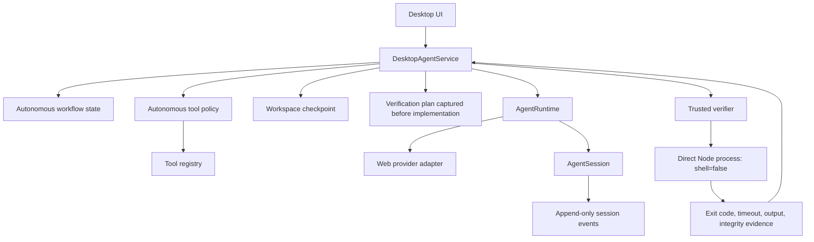
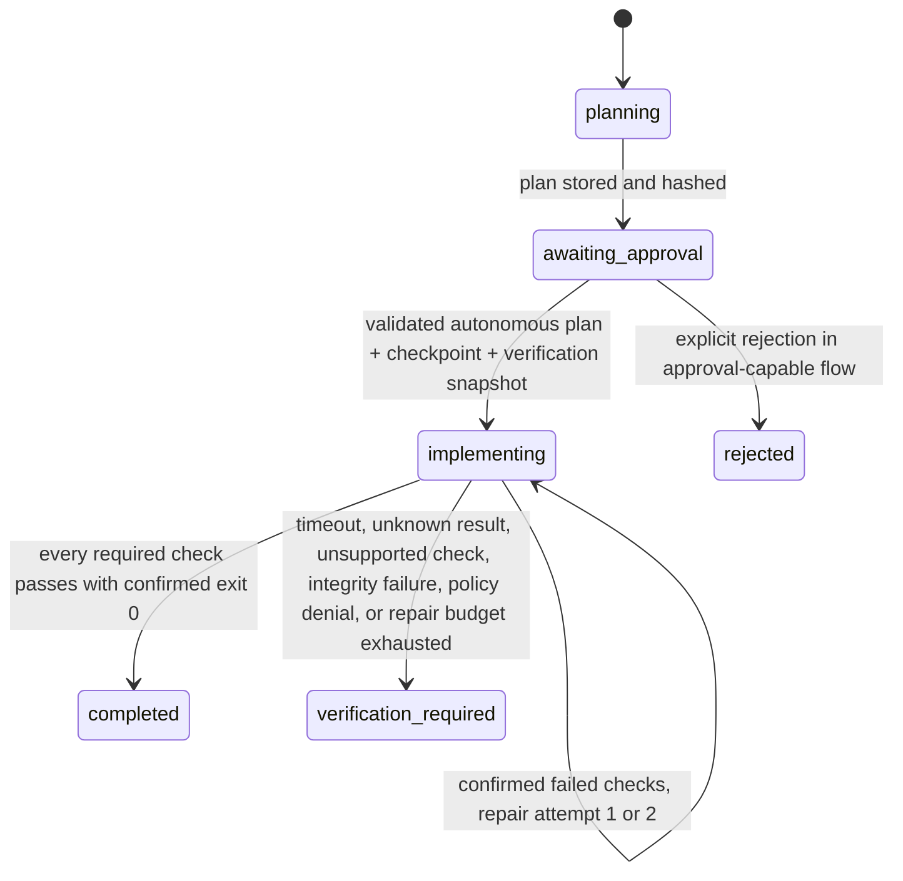

# Autonomous execution reliability

## Purpose and guarantee

WTAgent autonomous mode is a bounded workflow orchestrated by the desktop service and persisted in the session store. A model turn ending is never sufficient evidence of success. The service advances the task only from persisted state and machine-observed process results.

The implementation is deliberately narrower than a general-purpose autonomous shell agent:
- Planning is read-only.
- Implementation writes are limited to workspace file tools.
- Unmanaged terminal/process execution and unknown tools are denied without approval.
- Verification accepts only a pre-implementation snapshot of supported root package scripts.
- Recovery does not replay an outbound provider submission whose commit state is uncertain.

## Architecture and trust boundaries

Trust boundaries:
- Model output, plan text, source files, test output, and provider page content are untrusted input.
- Tool definitions are looked up in the trusted registry; missing definitions and risk mismatches fail closed.
- Autonomous policy decisions are enforced in the runtime tool path, not by relying on model instructions.
- Provider reconciliation is delegated to an adapter only when it supports correlation-based recovery and the exact saved browser target is available.
- The verifier's command descriptor is captured before implementation and is not re-derived from a potentially modified manifest afterward.

## Workflow state machine

Autonomous mode advances its validated plan without a renderer approval click. The `awaiting_approval` state is used as the persisted plan-validation boundary before the service atomically stores the implementation instruction, checkpoint identity, and verification plan. It must not be confused with user approval.

State meanings:
- `planning`: only read-only project tools are available.
- `awaiting_approval`: bounded plan and SHA-256 are persisted; implementation has not started.
- `implementing`: the checkpoint and verification plan have been persisted before the first implementation tool call.
- `completed`: reserved for machine verification; every required check must have a confirmed zero exit and unchanged verification inputs.
- `verification_required`: task is not complete. It includes failed, timed-out, unavailable, unsupported, integrity-failed, or policy-denied verification.
- `accepted`: where used by the manual review flow, this records a bounded user attestation and is not equivalent to machine-verified completion.

## Unattended tool policy

Allowed:
- Read-only workspace inspection and process metadata tools registered with read risk.
- `fs.write` and `fs.edit` only when the canonical target remains inside the selected workspace.
- New test files may be added, but existing baseline tests cannot be overwritten.

Denied:
- Unknown tools and risk/definition mismatches.
- Terminal execution, process start/stop, external or out-of-workspace writes.
- `.git`, `node_modules`, package manifests and lockfiles.
- Existing baseline test files and the captured verifier scripts.
- Writes when the workspace or canonical target cannot be validated.

The policy canonicalizes both workspace root and target. This is important on macOS, where `/tmp` may resolve through `/private/tmp`; lexical/canonical path mismatches must not bypass protected-file checks.

## Trusted machine verification

The verifier discovers only root `package.json` scripts named `test` and `check` that exactly match a direct `node <workspace-relative-script>` command. Shell syntax, command chains, absolute paths, traversal, symlink escapes, and unsupported script forms are rejected.

Before implementation, WTAgent snapshots:
- Root `package.json` hash.
- Supported package lockfile hashes.
- Every regular file under the baseline `test/` tree (bounded by file-count and byte budgets).
- Each accepted verification script hash and its direct executable/argv descriptor.

Before and after executing checks, the verifier validates the persisted plan and hashes. It launches the captured Node executable and script directly with `shell: false`, a reduced environment, a temporary home directory, bounded output, per-check and total time budgets, and process-tree termination escalation. A timeout without an observed process close is recorded as unknown completion, never as a pass.

A task is machine-complete only when:
1. The trusted plan was captured before implementation.
2. Every required supported check ran.
3. Every check ended with exit code `0` and `completionKnown: true`.
4. No unsupported check or integrity failure remains.
5. The autonomous tool policy did not deny an operation during implementation.

## Bounded repair

Repair is permitted only when the complete verification result proves that one or more checks exited nonzero and every other check has confirmed success. WTAgent:
- Allows at most two repair turns per task.
- Sends only failed-check evidence to the repair instruction.
- Re-runs only the failed check IDs.
- Merges rerun evidence by check ID and retains all prior passing evidence.
- Refuses to convert an integrity failure, unsupported check, policy denial, or unknown process completion into success.

Timeouts, spawn errors, missing evidence, unsupported commands, integrity failures, and policy denials are not repair triggers. Exhausting the repair budget leaves the task in `verification_required`.

## Durable session and crash recovery

`AgentSession` is the source of truth for session state. It uses atomic snapshots, revision checks, a serialized persistence queue, an inter-process lock, and append-only events. Workflow state, provider handoffs, pending tool results, and side-effect identities are persisted in that session; a second workflow store must not be introduced.

Recovery rules:
- Every outbound provider submission receives a correlation ID and is checkpointed before submission.
- An uncertain submission is reconciled against the exact saved conversation target when the provider adapter supports that operation.
- WTAgent never blindly resends an uncertain provider submission.
- Pending outbound, assistant-handoff, or tool-result state requires a bare resume. A new instruction is rejected before workflow mutation or instruction persistence.
- A pending auxiliary/media turn is blocked from automatic replay because the external side effect may already have occurred.
- Interrupted local side effects are reconciled through persisted operation identities and result ledgers; unknown completion remains unknown rather than being executed a second time.
- If the provider cannot prove a safe reconciliation boundary, the pending state remains intact for deliberate recovery.

The guarantee is conservative at-most-once behavior for uncertain submissions, not exactly-once execution across an external provider boundary. Exactly-once cannot be claimed where the provider does not expose a durable idempotency or reconciliation contract.

## Resource bounds

| Surface | Bound or control |
|---|---|
| Plan text | 24 KiB |
| Repair turns | 2 per task |
| Verification scripts | Direct Node script only; `test` / `check` |
| Verification output | 32 KiB per stream |
| Per-check timeout | 120 s test / 45 s check by default |
| Total verification budget | 180 s |
| Baseline snapshot | 2,000 files, 20 MiB per file, 128 MiB total |
| Persisted repair evidence | Bounded summaries and output tails |
| Unmanaged commands | Denied |

## Explicit limitations

This is not an OS sandbox. A project-owned Node verification script is executable project code and may itself spawn processes, access the network, or modify files. WTAgent constrains the launch descriptor, environment, time, output, and integrity checks, but does not provide filesystem namespaces, network isolation, syscall filtering, or a separate low-privilege OS account. Do not describe this verifier as safe execution of arbitrary untrusted repositories.

The verifier currently supports only direct Node scripts declared as root `test` and `check` package scripts. Other ecosystems and command shapes are reported unsupported rather than guessed or run through a shell.

Provider recovery depends on adapter capability. A provider that cannot reconcile the exact pending outbound state leaves the session blocked; the product must not silently choose a different conversation or replay the action.

## Validation strategy

The repository test suite covers:
- Policy denial and workspace path containment.
- Frozen manifest, lockfile, verifier script, and baseline test integrity.
- Direct process launch, output and timeout bounds, termination escalation, and unknown completion.
- Machine completion and targeted repair evidence merging.
- Session persistence, stale-writer conflicts, outbound correlation, provider reconciliation, tool-result recovery, side-effect deduplication, and bare-resume admission.
- Desktop lifecycle cancellation, shutdown, and subprocess supervision.

CI runs the cross-platform test matrix and desktop build. A code change is not considered validated until the current head commit has green required workflows; syntax success alone is insufficient.
